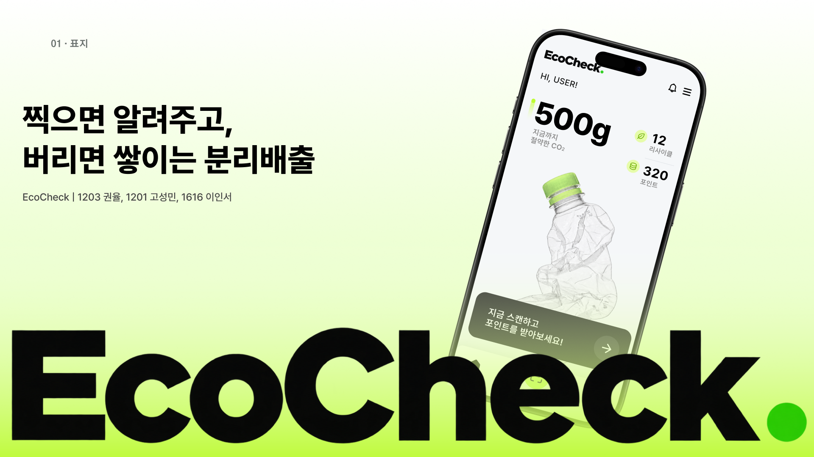

# EcoCheck


스마트폰 카메라로 쓰레기를 스캔하면 인공지능이 물체를 인식하여, 재질별 분리배출 방법과 세척/라벨 제거 등의 구체적인 행동 지침을 즉각적으로 알려주는 사용자 맞춤형 에코 가이드 서비스.

> 일시: 10월 23일 오후 7:00 ~ 10월 24일 오후 12시

## 기여자

| 프로필 | GitHub | 역할 | 담당 |
| :---: | :---: | :---: | :--- |
|  | **권율**<br>([@justcallmelightt](https://github.com/justcallmelightt)) | **Team Leader <br> Full-Stack** [N%] | Front-end, Back-end, Design |
|  | **고성민**<br>([@ksm524923](https://github.com/ksm524923)) | **Back-end** [N%] | MySQL, Java |
|  | **이인서**<br>([@iioct](https://github.com/iioct)) | **Design** [N%] | UI 디자인 |


## 현재 개발 구조

- **iOS (SwiftUI)**: 사진 촬영·선택, 서버 분석과 분리배출 안내, AI 실패 시 재질 직접 선택·기록 저장, 기록 조회·삭제, Apple MapKit 화면을 제공합니다. Core ML/Vision 코드는 남아 있지만 학습 모델이 없어 현재 스캔 흐름에서는 사용하지 않습니다.
- **Java (JDK HttpServer + JDBC, Spring Boot 미사용)**: Gemini 사진 분석, AI/수동 분류 기록 저장·조회·삭제, 주변 쓰레기통 검색을 담당합니다.
- **MySQL**: 확인한 스캔 기록과 쓰레기통 데이터를 저장합니다. 사진 자체는 서버나 DB에 저장하지 않습니다.

`아이폰 사진 → 전송 동의 → Java 서버 → Gemini 분석 → 사용자 확인 → Java 서버 → MySQL 기록 저장`

실행은 [Java/MySQL 안내](backend/README.md), 앱 설정은 [iOS 안내](iOS/README.md)를 참고하세요. Windows에서 Java 서버를 개발·실행할 수 있고 iOS 빌드·실행에는 Mac/Xcode가 필요합니다. 기존 기획서의 모바일 웹에서 iOS 앱 + Java/MySQL 구조로 변경했습니다. 실제 Gemini·네이버 키와 쓰레기통 좌표 데이터는 별도로 설정해야 합니다.


## Java 백엔드 재구성 상세

IntelliJ에서 `backend/pom.xml`을 Maven 프로젝트로 등록하고 JDK 17 이상을 선택하세요. 실행 클래스는 `kr.ecocheck.EcoCheckServerApplication`입니다. 실제 검증은 JDK 21에서 진행했습니다.

백엔드를 교체할 때 기존 iOS 화면과 Core ML 코드는 유지했습니다. 이후 iOS의 분석·저장 요청을 새 Gemini 분석 결과 ID 계약에 맞게 연결하고 네이버 지도 SDK 화면을 추가했습니다. 요청 형식은 `backend/API.md`에, 앱 연결 상태는 `iOS/README.md`에 있습니다. Java 서버는 쓰레기통 좌표 조회와 주소 변환을 제공합니다.

## 먼저 할 일

1. MySQL Workbench에서 MySQL Server에 연결하고 `backend/sql/schema.sql` 전체를 실행합니다.
2. `backend/.env.example`을 `.env`로 복사하고 DB URL·계정·비밀번호를 넣습니다.
3. Gemini API 키, 네이버 Maps Client ID·Secret을 `.env`에 넣습니다.
4. IntelliJ에서 Maven 새로고침 후 main을 실행합니다. 작업 디렉터리는 EcoCheck 또는 backend입니다.
5. `backend/requests.http`에서 `/health`와 `/categories`를 호출합니다.

Workbench는 DB 접속·SQL 실행 도구이고 실제 데이터는 MySQL Server에 저장됩니다. 서버를 설치·실행해야 합니다. 기존 DB/테이블은 삭제하지 않으며 새 `ecocheck_v2_*` 테이블을 사용합니다.

## 제공 기능

- Gemini 사진 재질 분류와 검토용 공통 분리배출 안내
- AI가 판단하기 어려운 경우 Figma의 재질 선택 흐름으로 안내 확인 및 수동 분류 기록 저장
- 불명확/미지원 물체 처리, JPEG/PNG 검증, 요청 크기·호출 시간 제한
- 사용자 확인 후 기록 저장, 기기 토큰별 기록 조회·삭제·총 개수
- 서울시 가로휴지통 원본 XLSX와 6,849개 변환 JSON
- 주소→좌표 변환 CLI, MySQL 적재 CLI, 주변 거리순 조회 및 일반/재활용 필터
- 외부 API 확인 명령, IntelliJ HTTP 요청 예제, 자동 테스트

탄소 절감량·포인트·회원가입·분리배출 행동 인증은 이번 구현에 포함하지 않습니다. 스캔 기록은 실제 배출 완료 증명이 아닙니다.

## 왜 이렇게 나눴는가

```text
앱 → EcoCheckHttpServer → AnalysisService → GeminiClient → Google Gemini
                     ├→ GuideService → shared/recycling-guides.json
                     ├→ BinService → MySqlRepository → MySQL Server
                     └→ MySqlRepository → 기록 저장·조회·삭제

원본 서울 XLSX → 변환 Python → JSON → NaverMapClient → 좌표 JSON → MySQL
앱의 Naver Maps iOS SDK → 지도 표시 → /api/v1/bins 응답을 마커로 표시
MySQL Workbench → SQL 실행·데이터 확인
```

| 변경할 내용 | 수정할 파일 | 나눈 이유 |
|---|---|---|
| API 주소, 입력 검사, 응답 코드 | EcoCheckHttpServer.java | HTTP 처리와 기능 로직 분리 |
| 분석 결과 사용·보관·저장 조건 | AnalysisService.java | 확실하지 않은 결과와 임의 기록 저장 방지 |
| AI 요청·프롬프트·JSON 응답 | GeminiClient.java | AI 공급자 변경의 영향을 한 파일로 제한 |
| 분리배출 방법 문구·분류 | shared/recycling-guides.json | 앱과 서버가 같은 안내를 사용 |
| 거리·검색 반경·정렬 | BinService.java | 지도 로직을 DB/HTTP와 독립적으로 검증 |
| SQL과 테이블 접근 | MySqlRepository.java | Workbench에서 보는 구조와 SQL을 대응 |
| 네이버 인증·주소 변환 | NaverMapClient.java | 키를 앱에 넣지 않고 서버에서 사용 |
| 주소 정제·좌표 적재 | AdminCommands.java, scripts/convert-seoul-data.py | 비용 발생 작업을 공개 API에서 분리 |
| 키·DB 계정·포트 | backend/.env | 소스 수정 없이 설정 변경 |
| DB 테이블 | backend/sql/schema.sql | Workbench에서 직접 검토·실행 |

Spring Boot를 새로 도입하지 않고 기존 Java/Maven/JDBC 환경을 사용했습니다. 작은 기능 범위에서 요청→서비스→SQL 흐름을 직접 읽고 수정하기 쉽고, 프레임워크 설정을 동시에 배울 필요가 없기 때문입니다. 규모가 커지면 Controller/Service/Repository 역할을 유지하면서 Spring Boot로 옮길 수 있습니다.

## 실행 명령

```powershell
cd backend
.\mvnw.cmd package
java -jar target/ecocheck-server-0.1.0.jar
```

IntelliJ에서 패키지 구조가 보이지 않으면 `backend/pom.xml` 우클릭 → Add as Maven Project를 실행합니다. 서버가 이미 8080 포트를 사용하면 기존 실행을 종료하거나 `.env`의 포트를 변경하세요.

API와 iOS 연결 변경은 `backend/API.md`, 데이터 가져오기·키 발급·Workbench는 `backend/SETUP.md`, 검증 범위와 남은 항목은 `backend/TEST-RESULTS.md`에 있습니다.
